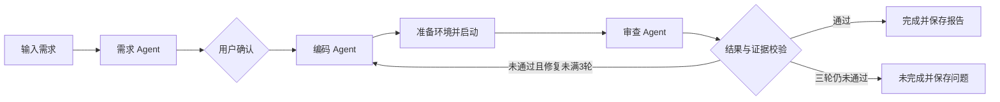

# 工序 · 软件开发 Workflow

输入需求，确认方案，三个 Agent 协作写入源码、启动应用并实际检查。工作台只展示当前任务，源码和最终报告直接保存在所选项目目录。


## 运行

需要 Windows、Python 3.11+、模型服务与安装依赖所需的网络；目前在 Python 3.11.9 上验证。模型接口需兼容 Anthropic Messages，包括工具调用，已验证配置是兼容服务上的 `deepseek-flash`。仅提供 OpenAI Chat Completions 接口的服务不能直接使用。

**从 Git 仓库克隆时，还需安装 Node.js 20.19+ 或 22.12+（含 npm）**：`frontend/dist` 不纳入 Git，`setup.ps1` 会按锁文件安装前端依赖并构建。作业压缩包已包含 `frontend/dist`，安装时会跳过这一步。

```powershell
# 在克隆或解压后的工程目录打开 PowerShell
.\setup.ps1
# 编辑安装脚本输出的 .env 路径，填写自己的模型配置
.\start.ps1
```

打开 <http://127.0.0.1:8765>。已有本地运行环境直接运行 `start.ps1` 即可。安装脚本把 Python 环境、浏览器、缓存和实际模型配置保存在旁边的 `swe-workflow-local` 目录中，工程文件夹只保留代码、文档、前端成品和视频。已有 `frontend/dist` 时无需构建前端。

若 PowerShell 提示禁止运行脚本，可在工程目录用以下命令分别安装、启动；执行策略仅对这次 PowerShell 进程生效：

```powershell
powershell.exe -NoProfile -ExecutionPolicy Bypass -File .\setup.ps1
# 配置安装脚本输出路径中的 .env 后再启动
powershell.exe -NoProfile -ExecutionPolicy Bypass -File .\start.ps1
```

保持一个服务进程，不添加 `--workers` 或热重载。Ctrl+C 退出并清理本次启动的应用服务。

首次安装会下载 Python 依赖及无界面 Chromium 浏览器；从 Git 克隆时还会下载 npm 依赖，需要能够访问相应下载服务。每个使用者填写自己的 API Key、Base URL 和模型名，不能只复制示例占位值。无需安装或复制作者的 `D:\Agent`、`swe-workflow-local`；本机运行目录会自动创建，已有目录时会复用。

## 使用

1. 选择“新建项目”及一个已有的空文件夹，或选“继续修改”及已有源码目录。
2. 输入需求。需求 Agent 整理功能、页面、技术方案和验收清单；可编辑后确认。
3. 编码 Agent 实际写文件，工作流准备依赖并启动应用。右侧可以操作预览，也可以独立打开。
4. 审查 Agent 只读检查源码，并执行浏览器操作、登记测试及适用的接口/数据检查。
5. 未通过则返回编码修复；首次实现之外最多三轮，随后明确结束为通过或未完成。
6. 需要继续修改时，选择“新任务 / 继续修改”，使用原目录重新提出需求并确认。

支持单页、多页面及带后端和数据库的应用，技术栈按用户要求或确认后的方案决定。生成项目需要的 Node.js、其他语言环境或第三方依赖应在本机准备；已验证简单案例不代表所有技术栈都能可靠完成。

## 结果保存与会话边界

生成源码在所选目录；最终结果在该目录的 `.workflow/`：

- `report.json`：需求、方案、实际检查结果、证据引用和启动方案。
- `execution.log`：本次角色交接、文件写入、工具检查和修复记录。
- 最多三张关键检查截图。

工作台只保留当前会话的一个任务。刷新页面可继续查看同一服务会话，关闭服务后不恢复任务进度；本地源码和报告仍然保留。新的任务需要重新检查，界面不沿用上次报告。

没有历史项目列表、任务数据库、跨重启恢复、修复批次或提案版本机制。旧版数据已移到 `D:\swe-workflow-local\.data`，新版运行不读取其中旧数据库。`.workflow` 是结果目录，Agent 文件列表和源码指纹会排除它。

## Agent 协作与架构



LangGraph 管理共享状态和节点顺序，三个角色内部各用 LangChain `create_agent` 组织模型与工具循环。Pydantic 校验提案、编码方案及报告；只有完整验收清单通过且具备相应实际工具证据，才标记完成。需求确认使用内存 Checkpointer，仅支持本次服务会话。

| 模块 | 职责 |
| --- | --- |
| `backend/app/workflow.py` | 共享状态、节点连接、证据校验、三轮修复上限 |
| `backend/app/agents.py` | 三个角色、模型配置、结构化结果及有限补全 |
| `backend/app/tools.py` | 文件、命令、服务、HTTP 与 Playwright 工具 |
| `backend/app/manager.py` | 当前任务、确认、停止、预览及结果文件 |
| `backend/app/main.py` | HTTP/SSE 和工作台静态文件 |
| `backend/app/models.py` | 输入输出协议 |
| `frontend/src/main.tsx` | 需求、进度、预览和当前报告 |

新增角色时定义提示词、输出类型和工具范围，再在 `workflow.py` 接入节点及连接。生成应用的数据库与工作流状态独立，工作流不用数据库不影响生成数据库应用。

## 配置、检查和开发

`.env.example` 提供配置名称，实际密钥文件位于工程旁边的“工程名-local”目录（例如 `D:\swe-workflow-local\.env`），工程文件夹中不保存实际密钥。生成应用进程不继承模型密钥。文件工具限制项目目录，浏览器工具限制已登记的本地服务；生成代码和依赖仍以当前用户权限运行，这不是操作系统沙箱。

```powershell
# 离线流程、API与结果恢复测试，不调用外部模型
.\python.ps1 -m pytest -q tests
# 真实模型测试，会消耗服务额度；需先启动工作台
.\python.ps1 scripts/check_model.py
.\python.ps1 scripts/live_acceptance.py single multi database --modify-single
```

前端开发依赖可在构建后移除，日常运行使用 `frontend/dist`。修改前端时：

```powershell
cd D:\swe-workflow\frontend
npm.cmd ci
npm.cmd run build
```

详细边界见 [需求](docs/requirements.md)、[设计](docs/design.md) 和 [验证记录](docs/validation.md)。

发布仓库时需提交 `setup.ps1`、`start.ps1`、`runtime.ps1`、`python.ps1`、前端源码及 `package-lock.json`、后端源码及 `requirements.txt`。实际密钥、Python 环境、浏览器、缓存和生成项目不用上传。这里的发布方式是让其他人下载后在 Windows 本机运行；尚未提供远程多人访问或云服务器部署方案。

## 直接压缩整个工程交作业

**直接压缩 `D:\swe-workflow` 整个文件夹即可，不需要手动排除文件。** 运行依赖和旧数据已经移到旁边的 `D:\swe-workflow-local`，压缩时只选择工程文件夹，不需要把旁边的本机运行目录一起选中。

| 目录 | 用途 |
| --- | --- |
| `D:\swe-workflow` | 源码、文档、前端成品和演示视频，可以整体压缩提交 |
| `D:\swe-workflow-local` | 本机 Python 环境、浏览器、缓存、密钥和旧数据，留在本机使用 |

工程放到其他位置时，本机目录会自动变为旁边的“工程名-local”。日常启动方式仍是 `start.ps1`。新机器解压后运行 `setup.ps1`，会在工程旁边自动建立自己的本机运行目录，再填写该目录的 `.env`。开发和测试命令统一通过 `python.ps1` 调用，避免依赖环境的具体位置。可用环境变量 `SWE_WORKFLOW_HOME` 自定义本机运行目录。

Git 历史保留在工程的 `.git` 中；包含它和现有视频时，整个工程仍小于200 MB。实际整包体积见本次交付结果。当前 `workflow2.mp4` 保留原样，约2分36秒，正式演示仍需控制在一分钟以内。

如果需要另做纯源码包，也可运行：

```powershell
.\python.ps1 scripts/package_submission.py --name "学号姓名"
```

该可选源码包保存到本机运行目录的 `submission/`，不会在工程文件夹内再嵌套压缩包。
