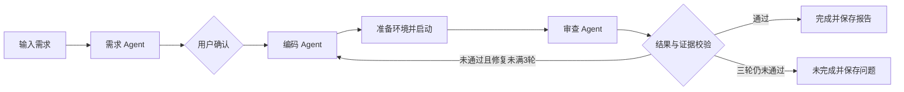

# 工序 · 软件开发 Workflow

输入需求，确认方案，三个 Agent 协作写入源码、启动应用并实际检查。工作台只展示当前任务，源码和最终报告直接保存在所选项目目录。

[源码仓库](https://github.com/KCxuan/swe-workflow)


## 运行

需要 Windows、Python 3.11+、模型服务与安装依赖所需的网络；目前在 Python 3.11.9 上验证。模型接口需兼容 Anthropic Messages，包括工具调用，已验证配置是兼容服务上的 `deepseek-flash`。仅提供 OpenAI Chat Completions 接口的服务不能直接使用。

若工程中没有 `frontend/dist`，还需安装 Node.js 20.19+ 或 22.12+（含 npm），安装脚本会自动构建前端；已有前端成品时跳过构建。

```powershell
# 在克隆或解压后的工程目录打开 PowerShell
.\setup.ps1
# 编辑安装脚本输出的 .env 路径，填写自己的模型配置
.\start.ps1
```

打开 <http://127.0.0.1:8765>。首次安装后，日常使用直接运行 `start.ps1`。Python 环境、浏览器与模型配置保存在工程旁边的“工程名-local”目录中；可用环境变量 `SWE_WORKFLOW_HOME` 自定义该目录。

若 PowerShell 提示禁止运行脚本，可在工程目录用以下命令分别安装、启动；执行策略仅对这次 PowerShell 进程生效：

```powershell
powershell.exe -NoProfile -ExecutionPolicy Bypass -File .\setup.ps1
# 配置安装脚本输出路径中的 .env 后再启动
powershell.exe -NoProfile -ExecutionPolicy Bypass -File .\start.ps1
```

保持一个服务进程，不添加 `--workers` 或热重载。Ctrl+C 退出并清理本次启动的应用服务。

首次安装会下载 Python 依赖及无界面 Chromium 浏览器；从 Git 克隆时还会下载 npm 依赖，需要能够访问相应下载服务。每个使用者填写自己的 API Key、Base URL 和模型名，不能只复制示例占位值。本机运行目录会自动创建，已有目录时会复用。

## 使用

1. 选择“新建项目”及一个已有的空文件夹，或选“继续修改”及已有源码目录。
2. 输入需求。需求 Agent 整理功能、页面、技术方案和验收清单；可编辑后确认。
3. 编码 Agent 实际写文件，工作流准备依赖并启动应用。右侧可以操作预览，也可以独立打开。
4. 审查 Agent 只读检查源码，并执行浏览器操作、登记测试及适用的接口/数据检查。
5. 未通过则返回编码修复；首次实现之外最多三轮，随后明确结束为通过或未完成。
6. 需要继续修改时，选择“新任务 / 继续修改”，使用原目录重新提出需求并确认。

支持单页、多页面及带后端和数据库的应用，技术栈按用户要求或确认后的方案决定。生成项目需要的 Node.js、其他语言环境或第三方依赖应在本机准备；已验证简单案例不代表所有技术栈都能可靠完成。

## 结果保存与会话边界

生成源码在所选目录；最终结果在该目录的 `.workflow/`：

- `report.json`：需求、方案、实际检查结果、证据引用和启动方案。
- `execution.log`：本次角色交接、文件写入、工具检查和修复记录。
- 最多三张关键检查截图。

工作台只保留当前会话的一个任务。刷新页面可继续查看同一服务会话，关闭服务后不恢复任务进度；本地源码和报告仍然保留。新的任务需要重新检查，界面不沿用上次报告。

## Agent 协作与架构



LangGraph 管理共享状态和节点顺序，三个角色内部各用 LangChain `create_agent` 组织模型与工具循环。Pydantic 校验提案、编码方案及报告；只有完整验收清单通过且具备相应实际工具证据，才标记完成。需求确认使用内存 Checkpointer，仅支持本次服务会话。

| 模块 | 职责 |
| --- | --- |
| `backend/app/workflow.py` | 共享状态、节点连接、证据校验、三轮修复上限 |
| `backend/app/agents.py` | 三个角色、模型配置、结构化结果及有限补全 |
| `backend/app/tools.py` | 文件、命令、服务、HTTP 与 Playwright 工具 |
| `backend/app/manager.py` | 当前任务、确认、停止、预览及结果文件 |
| `backend/app/main.py` | HTTP/SSE 和工作台静态文件 |
| `backend/app/models.py` | 输入输出协议 |
| `frontend/src/main.tsx` | 需求、进度、预览和当前报告 |

新增角色时定义提示词、输出类型和工具范围，再在 `workflow.py` 接入节点及连接。生成应用的数据库与工作流状态独立，工作流不用数据库不影响生成数据库应用。

## 配置、检查和开发

`.env.example` 提供配置名称，实际密钥文件位于工程旁边的“工程名-local”目录，工程文件夹中不保存实际密钥。生成应用进程不继承模型密钥。文件工具限制项目目录，浏览器工具限制已登记的本地服务；生成代码和依赖仍以当前用户权限运行，这不是操作系统沙箱。

```powershell
# 离线流程、API与结果恢复测试，不调用外部模型
.\python.ps1 -m pytest -q tests
# 真实模型与工具调用检查，需要有效模型配置
.\python.ps1 scripts/check_model.py
# 完整开发流程检查，需要先启动工作台
.\python.ps1 scripts/live_acceptance.py single multi database --modify-single
```

修改前端后，执行以下命令重新构建：

```powershell
Set-Location .\frontend
npm.cmd ci
npm.cmd run build
```

详细边界见 [需求](docs/requirements.md)、[设计](docs/design.md) 和 [验证记录](docs/validation.md)。
