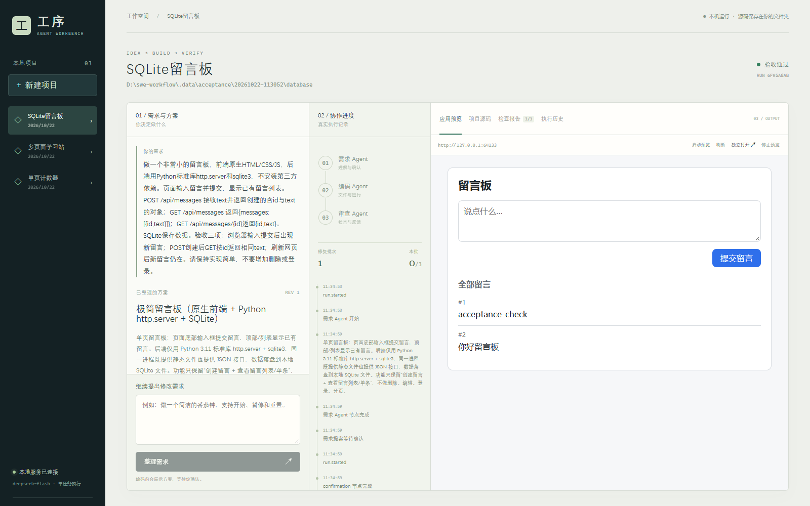
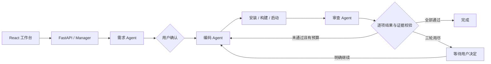

# 工序 · 本地 Agent 软件开发工作台

输入需求，确认方案，由三个 Agent 依次完成编码和实际检查。生成的源码直接保存在用户选择的本地文件夹中，工作台展示协作进度、应用预览、源码与逐项验收报告。

本项目独立实现，**不导入或调用 `D:\Agent` 的 CodingAgent**。LangGraph 控制角色交接与人工等待，角色内部使用 LangChain `create_agent` 调用模型和工具。



## 运行

环境：Windows、Python 3.11+、Node.js 20.19+ 或 22.12+。本次实际验证环境为 Python 3.11.9、Node.js 24.11.1。需要模型服务及依赖下载网络。

```powershell
cd D:\swe-workflow
.\setup.ps1
# 在 .env 填写自己的模型配置
.\start.ps1
```

浏览器打开 <http://127.0.0.1:8765>。`setup.ps1` 创建独立 `.venv`，安装锁定依赖、Chromium，构建前端；已有本地环境可直接运行 `start.ps1`。PowerShell 若因本机脚本策略拒绝执行，可用以下命令直接启动：

```powershell
.\.venv\Scripts\python.exe -m uvicorn backend.app.main:app --host 127.0.0.1 --port 8765
```

后端只运行一个进程；不要添加 `--workers` 或开发热重载。退出时按 Ctrl+C，工作台会清理自己启动的应用服务。

## 模型配置

复制 `.env.example` 为 `.env`，填写 `ANTHROPIC_API_KEY`、`ANTHROPIC_BASE_URL` 和 `ANTHROPIC_MODEL`。这里使用 **Anthropic Messages 兼容协议**，模型别名本身不决定协议。当前已验证服务的 `deepseek-flash` 能完成工具调用和结构化输出；其他服务或模型需要另行验证。

配置只由本项目后端读取。生成应用进程不继承模型凭据；`.env`、运行记录和本地依赖不纳入源码提交。请勿将真实密钥填入示例文件或需求中。

## 使用与演示

1. 新建项目，选择一个**已经存在的空文件夹**。也可直接填写绝对路径。已有文件不会被清空。
2. 输入需求。需求 Agent 给出功能、页面、技术方案和验收清单；可直接编辑，或补充要求重新生成。
3. 确认提案，编码 Agent 才开始写文件。服务启动后可在右侧操作应用，查看源码与实时执行记录。
4. 审查 Agent 只读检查源码，通过 Playwright 实际点击、输入、断言，也可调用接口及登记的检查脚本。报告引用工具证据和截图。
5. 检查未通过会自动修复，首次实现之外每批最多三轮。次数用尽等待“继续修复”“重新整理需求”或“结束”。
6. 从侧栏打开历史项目，提出新的修改需求。失败、停止或中断后可以手动重试；重试继承原修复预算。

适合短演示的需求：

- 单页：计数器，点击加一和重置。
- 多页面：首页输入姓名显示问候，链接进入关于页并返回。
- 带后端数据库：SQLite 留言板，提交留言、接口读写、刷新后仍能看到留言。

工具不固定生成项目的技术栈；Agent 按需求提出方案并等待确认。运行其他语言或框架需要本机具备相应环境。已跑通简单案例不代表任意技术栈或复杂项目都能成功。

## 协作架构



外层是 LangGraph 共享状态与条件路由，内层三个 `create_agent` 分别拥有不同提示词和工具。提案、编码方案、检查报告用 Pydantic 校验。SQLite Checkpointer 保存人工等待点，业务 SQLite 保存项目、执行、事件和服务身份；SSE 从已保存的事件补读。

| 文件 | 职责 |
| --- | --- |
| `backend/app/main.py` | HTTP/SSE、目录选择、源码/报告接口、静态工作台 |
| `backend/app/manager.py` | 单任务槽、确认、停止、重试、预览生命周期 |
| `backend/app/workflow.py` | 共享状态、节点连接、修复预算、证据校验 |
| `backend/app/agents.py` | 模型工厂、三个角色及工具调用循环 |
| `backend/app/models.py` | 输入输出协议 |
| `backend/app/tools.py` | 文件、命令、服务、浏览器与 HTTP 工具 |
| `backend/app/store.py` | SQLite 业务记录 |
| `frontend/src/main.tsx` | 需求确认、进度、预览、源码、报告与历史界面 |

新增角色时在 `agents.py` 定义提示词/输出类型/工具范围，在 `workflow.py` 接入节点和连接；新增协议在 `models.py` 定义。相关结果需要专门展示时再扩充前端。扩展需要开发，不要求重写现有三个角色。

## 验证

```powershell
# 离线状态机、证据与API测试，不调用模型
.\.venv\Scripts\python.exe -m pytest -q tests

# 明确调用真实模型，会消耗服务额度；在 .data/acceptance 新建示例目录
.\.venv\Scripts\python.exe scripts/check_model.py
.\.venv\Scripts\python.exe scripts/live_acceptance.py single multi database

cd frontend
npm.cmd run build
```

真实示例脚本只对它自己建立的测试需求自动确认，工作台产品本身始终等待用户确认。详细执行结果、证据位置与验证边界见 [验证记录](docs/validation.md)。需求和技术设计见 [需求文档](docs/requirements.md)、[设计文档](docs/design.md)。

## 当前边界

- 本地、单用户、同时一个执行任务；只登记空目录或打开本系统已有项目。
- 源码保留最新状态，不保存历史版本，不提供回滚。停止时可能留下尚未完成的修改。
- 重启不自动恢复正在执行的任务；等待人工确认的任务可以明确继续。
- 报告绑定检查时的源码指纹，源码发生变化后只作为历史结果展示。验收项全通过才结束为完成，模型自述不作为执行证据。
- 文件工具限制项目路径、子进程隔离模型环境变量、浏览器工具限制已登记本地端口；**这不是操作系统沙箱**。生成代码、依赖安装和测试脚本仍以当前 Windows 用户权限运行，适合可信需求和本地演示。
- 模型调用采用完整结构化结果；工作台实时展示的是节点和工具事件，不逐 token 显示模型文字。

提交源码时排除 `.env`、`.venv/`、`.data/`、`.cache/`、`frontend/node_modules/`、`frontend/dist/`、`output/`、缓存和日志。保留 `requirements.txt`、`package-lock.json`、配置示例、启动脚本、源码和文档；演示视频需自行录制，不包含在已执行验证中。
