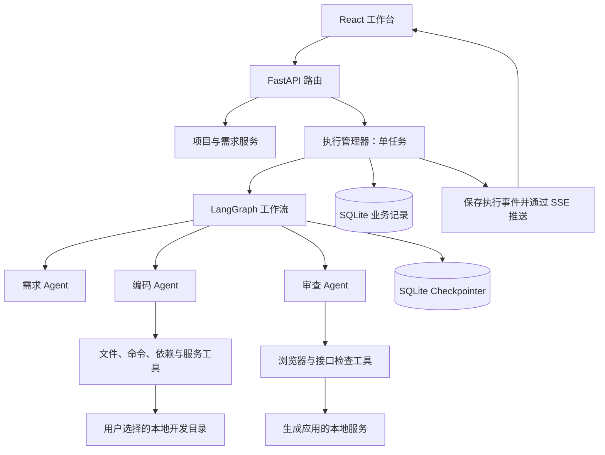
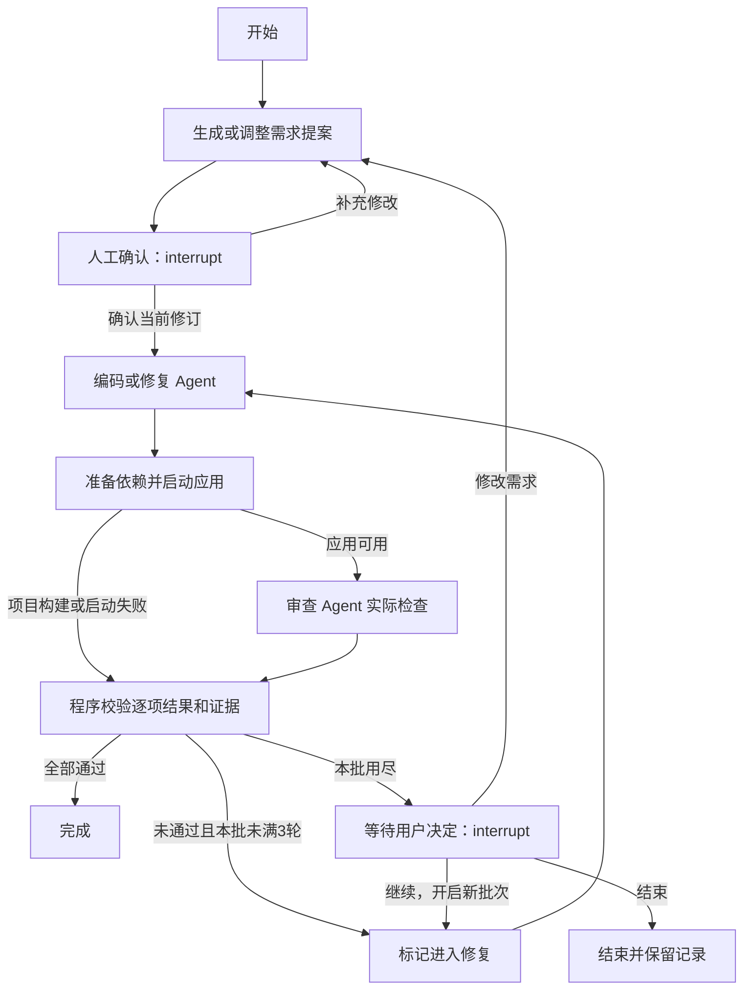

# 通用软件开发工作流：技术设计

版本：v1.1，MVP 实现同步  
更新日期：2026-10-22  
需求依据：[需求文档 v1.1](requirements.md)

本文描述已经实现的 MVP。当前实现和验证边界见 [验证记录](validation.md)；新增功能仍需按需求验证。

## 1. 设计目标与已确认选择

工具在本机运行，用户通过浏览器选择开发目录、确认需求、观察 Agent 进度并操作生成的软件。第一版只有一个任务执行槽，可以管理多个历史项目。

| 层次 | 技术与职责 |
| --- | --- |
| 工作台 | React + TypeScript + Vite，展示需求、流程、源码、报告和应用预览。 |
| 本地 API | Python + FastAPI，处理项目、确认、执行、停止、历史和事件请求。 |
| 外层工作流 | LangGraph，规定角色顺序、人工确认、检查分支和修复预算。 |
| 角色内部 | LangChain `create_agent`，组织模型与角色可用工具之间的循环。 |
| 保存 | SQLite 保存业务记录；SQLite Checkpointer 保存人工等待所需的图状态。 |
| 执行工具 | 本地文件操作、命令执行、依赖安装、服务管理、HTTP 检查和 Playwright。 |

以上技术栈用于开发工作流工具自身。生成项目的语言、框架、数据库由用户指定，或由需求 Agent 提出方案后确认。

LangChain 支持将模型实例、提示词和工具交给 `create_agent` 构造工具调用循环；角色分工和工具实现仍由本项目提供。[官方 Agent 文档](https://docs.langchain.com/oss/python/langchain/agents)

## 2. 总体架构与请求流



以“新建一个待办应用”为例：

1. 工作台将用户选中的空目录登记为项目，目录检查失败则返回明确说明，不清理已有文件。
2. 用户输入需求，执行管理器启动一次图执行，需求 Agent 生成提案。
3. 提案包含功能、页面结构、技术方案和逐项验收标准。图暂停，工作台显示提案供修改或确认。
4. 用户确认后，继续执行编码、环境准备、服务启动和审查。
5. 审查调用实际工具获得结果。普通程序校验报告是否覆盖确认的验收项，再决定完成、修复或等待用户处理。
6. 源码直接留在所选目录；工作台展示预览、进度、报告和历史记录。

API 路由只负责请求校验和调用服务，Agent 不调用路由函数。共享逻辑放在服务层，由节点和工具复用。

## 3. 模块边界

当前按职责拆分为下列模块；第一版使用平铺文件，避免为小规模代码建立过多空目录。

```text
backend/app/
  main.py        API、SSE、目录选择与工作台静态文件
  models.py      请求、提案、编码结果和检查报告
  manager.py     单任务、人工决定、停止、重试与预览
  workflow.py    共享状态、图组装、节点和证据判断
  agents.py      角色提示词、模型及 create_agent 工厂
  tools.py       文件、命令、服务、HTTP 和浏览器工具
  store.py       SQLite 业务记录
  config.py      独立本地配置
frontend/src/
  main.tsx       工作台与 HTTP/SSE 客户端
  style.css      布局和样式
scripts/         模型兼容探针与真实案例验收
tests/          离线状态机、证据及 API 测试
```

运行数据放在工具自身的 `.data/` 中，包括业务数据库、Checkpoint 数据库和按执行分类的检查证据。该目录与本地模型配置均不纳入源码提交。用户生成项目的源码保存在用户选定目录中，不搬到工具内部。

## 4. Agent、工具与输出约定

| 角色 | 输入 | 工具范围 | 输出 |
| --- | --- | --- | --- |
| 需求 Agent | 用户描述、已有提案、当前项目说明、环境能力摘要 | 需要时只读查看当前项目结构和文件 | `RequirementPlan`：标题、说明、功能、页面、技术方案和验收项。 |
| 编码 Agent | 确认提案、项目目录、最新源码、待修复问题和实际日志 | 列出/读写项目文件、运行短期命令；给出依赖、构建与服务启动方案 | `CodingResult`：变更文件、修改摘要、环境/构建命令、服务和登记检查。 |
| 审查 Agent | 确认提案、最新代码、启动结果和已有检查记录 | 只读检查源码、运行登记的检查任务、HTTP 请求、Playwright 操作；证据写入本次检查目录 | `ReviewReport`：逐项结果、证据引用、问题和修复建议。 |

需求和审查角色不提供修改项目业务源码的文件工具。审查角色通过专用检查工具运行测试，不开放任意命令执行入口；发现代码问题交回编码角色处理。浏览器和接口检查可以改变被测应用的测试数据，检查使用的数据及相关结果要记录。

三个角色可以使用同一模型实例配置，提示词、上下文和可用工具分别定义。角色交接使用校验后的结构化结果，而不是将全部历史聊天无区别传给下一角色。

结构化输出使用 Pydantic 校验。实际模型服务不支持某种结构化输出方式时，在兼容性验证后选用支持的工具输出或文本 JSON 解析方式；格式错误明确记录，不能转换为“通过”。工具循环另设调用次数和时间预算，避免将一次 Agent 执行误认为没有上限。

## 5. 共享状态与业务实体

外层图的共享状态保存可序列化的数据，数据库连接、进程对象、浏览器实例和密钥留在运行时服务中。

| 状态字段 | 含义 |
| --- | --- |
| 项目/执行标识和目录 | 保存在业务记录和运行时 ToolContext 中，不重复放入图状态。 |
| `request`、`plan_revision`、`plan` | 当前需求、提案修订号和结构化提案。 |
| `approved_revision` | 用户确认的提案版本，必须与本次编码使用的提案一致。 |
| `phase`、`status` | 当前阶段和运行状态。 |
| `coding_result`、`runtime` | 编码结果和服务地址；进程对象留在进程管理器。 |
| `review_report`、`source_hash` | 检查结果、其中的证据引用和被检查源码指纹。 |
| `batch_id`、`repair_count`、`total_repairs` | 修复批次、本批已完成修复轮数和累计轮数。 |
| `is_repair`、`issues`、`error` | 是否处于修复轮、需要修复的问题和执行错误。 |

一次修复轮包含修改和重新检查。重新检查得到项目自身的成功或失败结果后，增加本批和累计已完成轮数；修复后仍然构建或启动失败也属于检查失败，计入这一轮，不以成功启动或走完浏览器检查为计数前提。首次编码不计修复轮。安装、模型服务或工具故障终止执行时，当前未结束的轮次记录为中断，不冒充已完成轮次。

业务数据库至少包含：

| 实体 | 保存内容 |
| --- | --- |
| `projects` | 开发目录、项目说明和最近一次执行。 |
| `runs` | 需求与确认快照、状态、阶段、修复计数、图线程标识、父执行标识和错误。 |
| `events` | 单调递增事件编号、所属执行、事件类型、脱敏载荷和时间。 |
| 检查结果 | 存在 `runs.state` JSON 内；完整工具证据另存执行目录 `evidence.jsonl`，未单设 checks 表。 |
| `services` | 系统启动的服务标识、所属项目和执行、进程身份、端口及状态。 |

历史报告绑定当次提案与源码指纹。指纹不保存旧源码；打开历史项目或再次检查时，不能将旧报告自动用于修改后的文件。

每次编码或修复后，将当前验收结果重置为待检查，并对本次源码重新建立指纹；上一轮结果保留为记录，不直接累加为本轮通过项。检查结束时再次核对指纹，源码在检查期间变化则本轮报告不能用于标记完成。

## 6. 图编排、人工确认与停止



项目自身构建、启动报错进入同一修复预算；依赖安装、模型服务、系统环境或工作流工具失败则记录后停止本次自动流程，等待手动重试。异常分支由执行管理器统一处理。

构建或启动失败时，程序保存失败日志，形成对应失败检查项，尚不能执行的页面检查标记为未执行，再进入统一的结果判断。处于修复轮时，本轮检查结束即增加计数，然后判断下一轮预算，避免启动失败导致无限修复。

### 6.1 等待用户的实现

使用 LangGraph `interrupt()` 表达需求确认和修复次数用尽后的人工决定。每次执行使用独立 `thread_id`，配合 SQLite Checkpointer；恢复时由 API 校验提案修订号，再传入 `Command(resume=...)`。[官方 Interrupts 文档](https://docs.langchain.com/oss/python/langgraph/interrupts)、[官方持久化文档](https://docs.langchain.com/oss/python/langgraph/persistence)

等待节点保持简单，不生成文件、不创建进程、不在 `interrupt()` 前重复写入记录，也不以宽泛异常捕获吞掉图的中断信号。提案在前一节点产生，暂停所需状态保存成功后，执行管理器保存可见提案和等待状态，再向界面发送通知。

点击确认、继续或重试都需要状态校验；重复请求不重复启动执行，过期提案不能启动编码。提案修订后，旧确认失效。第一版前后端不提供拖拽编排功能。

### 6.2 单任务执行槽

FastAPI 以单应用进程运行。执行管理器持有当前活动任务，进程内异步锁约束活动执行槽，数据库唯一索引约束同一项目的未结束任务，防止双击或多个页面重复启动。该实现要求单个应用进程。忙碌时新执行请求返回明确的忙碌结果，当前项目记录保持原样。

需求确认和修复决定处于人工等待状态时，不占用活动执行槽；同一项目只允许一个未结束的执行，避免两个提案同时修改同一目录。用户确认时重新获取执行槽，若其他任务正在执行，保留等待状态并提示稍后操作。

### 6.3 停止与重启

停止先进入 `stopping` 状态：阻止后续节点和工具开始，取消活动模型请求及检查，等待已经开始的文件写入结束，并清理本次执行由系统启动的相关进程。清理完成前不释放活动槽，不显示为已停止。

重启后保留历史项目、提案、报告和进度。此前正在执行的任务标记为中断，不自动恢复。失败、已停止和中断的任务均可由用户手动重试；重试新建执行标识并保留父执行和旧记录，使用项目最新源码，不从任意工具调用中间恢复。

重试起点取决于确认状态：存在有效的已确认提案时，从编码与实际检查流程重新开始；没有有效确认时，回到需求生成或确认阶段，不能跳过用户确认。

同一需求的手动重试继承原修复批次、本批已完成轮数和累计轮数，未完成轮次保留中断记录。本批预算已满时，先等待修复决定；只有用户明确选择继续才开启下一批，重试按钮不能隐式清零预算。用户提出并确认新的修改需求时，创建新的任务并保存旧任务记录。

原本就在等待需求确认或修复决定的任务仍显示等待状态；只有用户操作才恢复相应检查点。这与中断中的任务不自动恢复的产品规则一致。

## 7. 本地工具与服务生命周期

### 7.1 文件和目录

用户可以选择目录或填写本地绝对路径，前后端均显示最终开发位置。登记新项目时检查目录存在且为空；确认需求、首次写入前再次检查，防止等待期间目录已被放入其他内容。历史项目则按已有登记打开。

文件工具规范化路径，限制到该项目目录；对越界路径或解析后越界的链接返回错误。检查证据通过专用工具写入本次证据目录。文件工具和项目命令不会获得读取工作流工具模型配置的接口。

### 7.2 命令、依赖和服务

命令工具记录程序、参数、退出码和实际输出；普通命令输出上限 2MB，超过上限停止并记录错误，界面事件只显示摘要，完整工具记录保存在证据文件中。普通命令有超时和取消机制；长期应用通过服务管理器启动，不能把“进程已创建”直接当作“应用已可用”。

依赖按项目准备，例如 Python 虚拟环境、项目自己的 Node 依赖目录。检测缺少运行环境或安装失败后停止并说明原因，不静默替换用户确认的技术栈。

服务管理器记录自己启动的进程身份和端口，等待健康检查通过后提供预览地址。修复前按需停止旧服务，重启并检查新实例，防止审查旧进程。清理仅作用于本系统登记的相应进程及子进程。

验收完成后允许保留应用供预览；切换到另一项目启动服务前，先停止前一项目的受管理预览服务。用户可以重新启动历史项目预览，退出工具时清理自身管理的应用服务。工作目录和路径限制属于应用层约束，不声称是操作系统沙箱。

手动预览的启动、停止和项目切换也经过执行管理器。其他项目正在开发或检查时，不能通过预览接口停止它的服务或切换预览实例；需要先结束当前执行。当前执行已经创建的服务由该执行管理，界面查看预览不会另起重复实例。

### 7.3 实际检查与证据

Playwright 使用本次执行的浏览器上下文操作生成应用，收集操作结果、页面信息、截图和错误；接口和数据存储需求另执行相关读写检查。浏览器实例保留在运行时服务中，不进入图状态。[Playwright 官方说明](https://playwright.dev/python/docs/intro)

模型可以提出检查步骤并解释结果，最终结果必须引用已经记录的工具证据。程序核对确认清单的项标识、状态和证据引用，缺项、未知项、无效引用或未执行项不能满足完成条件。仅有截图不能证明接口或数据持久化已经通过。

## 8. API 与实时事件

以下接口已实现，启动后可在 `/docs` 查看实际 OpenAPI。

| 请求 | 作用 |
| --- | --- |
| `POST /api/projects` | 校验空目录并登记新项目。 |
| `GET /api/projects` | 查看历史项目。 |
| `GET /api/projects/{id}` | 获取项目、最新运行和预览状态。 |
| `POST /api/projects/{id}/runs` | 提交新建需求或继续修改需求，返回执行标识。 |
| `GET /api/runs/{id}` | 获取状态、阶段、提案、计数、检查结果及源码是否仍匹配报告。 |
| `GET /api/runs/{id}/evidence` | 读取完整工具证据；截图由 artifacts 接口提供。 |
| `GET /api/health`、`POST /api/pick-directory` | 服务配置状态、Windows 目录选择器。 |
| `POST /api/runs/{id}/decision` | 提交确认、调整需求、继续修复或结束；携带预期修订号和决定标识。 |
| `POST /api/runs/{id}/stop` | 请求停止，返回当前停止进度。 |
| `POST /api/runs/{id}/retry` | 为失败、已停止或中断任务创建新的手动重试执行，按确认状态选择起点并继承修复预算。 |
| `GET /api/runs/{id}/events` | SSE 订阅执行事件，支持从已收到的事件编号继续读取。 |
| `GET /api/projects/{id}/files` | 列出源码文件。 |
| `GET /api/projects/{id}/files/content` | 在目录边界内读取源码内容。 |
| `POST /api/projects/{id}/preview` | 启动已登记项目的应用预览。 |
| `DELETE /api/projects/{id}/preview` | 停止该项目由系统启动的预览服务。 |

执行型接口先提交执行记录，再由执行管理器运行后台任务并返回 `202`；SSE 连接只负责展示，不持有模型执行生命周期。页面刷新或 SSE 断开不自动取消任务。

事件采用 `id`、`run_id`、`type`、`created`、`payload` 结构，类型覆盖节点开始结束、工具操作、提案等待、检查结果、修复批次、停止和执行终态。先保存事件和对应业务状态，再向工作台推送；重连按事件编号补读。模型密钥和请求鉴权头不进入事件。

SSE 使用 FastAPI 支持的事件响应方式，按锁定版本落实；浏览器断线后的事件补读由本项目的保存记录负责，不能只依赖内存队列。[FastAPI SSE 官方文档](https://fastapi.tiangolo.com/tutorial/server-sent-events/)

## 9. 工作台展示方案

界面以简洁的本地开发工作台为目标：左侧需求对话与确认提案，中部流程进度和工具操作摘要，右侧应用预览；源码与报告作为可切换视图。展示文字使用中文。

执行时间线读取持久化事件，可显示重复执行和新增节点。顶部三角色导览由前端角色列表定义，新增角色时同步扩充导览；修复循环展示当前批次和本批次数。每条验收项可展开查看结果与证据，历史报告明确标注所属执行。

预览应用使用独立本地端口，与工具自身接口保持不同来源；嵌入预览按需要限制 iframe 能力。无法嵌入时提供独立打开链接，源码查看仍由工作台接口完成。

首次实现使用克制的开发工具视觉风格，以明确的等待、运行、通过和失败状态区分操作进展，避免为演示界面额外增加业务流程。

## 10. 模型配置与当前核对结果

本次只读核对发现：原项目通过 `anthropic.Anthropic`／`AsyncAnthropic` 调用 Messages 接口，使用 `ANTHROPIC_API_KEY`、`ANTHROPIC_BASE_URL`、`ANTHROPIC_MODEL`。当前本地模型配置值为 `deepseek-flash`；服务地址和密钥已配置。初次核对依据为原项目 `main_async.py` 和 `CodingAgent/config.py`；随后已在本项目发起独立模型请求验证，原项目未修改。

新项目使用自身的本地配置，不修改原 Agent 的文件或环境。初次接入通过单独初始化的 `ChatAnthropic` 实例连接原服务，再把该实例传给角色工厂，不按 `deepseek-flash` 字符串猜测接口类型。[LangChain ChatAnthropic 文档](https://docs.langchain.com/oss/python/integrations/chat/anthropic)

已验证基本消息、真实工具调用往返、ToolStrategy 结构化结果及三个角色的实际调用。未使用逐 token 模型流，界面通过 SSE 接收节点和工具事件。官方适配器具备某机制不等于原服务已全部兼容。另一候选 `openai-6-luna` 的准确模型 ID 及可用协议在切换前单独核对。

密钥只在后端初始化客户端时读取，不返回前端，不写入提示词、日志或报告，不作为生成应用进程的环境变量传递。共享材料提供占位配置示例，实际本地配置和 `.data/` 排除在提交范围外。

## 11. 可扩展性与开发顺序

Agent 节点分别实现，图的节点和连接集中组装；文件、进程、存储和浏览器工具与提示词分离。新增独立角色时编写节点、按需要补充状态并修改图连接，已有角色实现应能够复用。扩展不是零开发工作。

例如增加“文档生成 Agent”，可以在审查通过后接入新节点，读取已确认需求和产物说明，再产生文档结果；不要求重写原需求、编码和审查角色。需要新增结果类型时再扩充对应界面显示。

开发与验证按以下顺序推进：

1. 校验依赖环境与模型工具调用兼容性，建立独立配置。
2. 实现项目登记、记录保存、三角色最小执行链和人工确认。
3. 实现真实文件工具、运行服务、检查证据和修复预算。
4. 接入工作台、事件展示、预览和源码报告视图。
5. 完成停止、手动重试、历史项目与继续修改。
6. 对照需求文档的 AC-01～AC-15 验收，分别用简单案例验证三类应用。

静态检查、使用模拟模型的流程检查、真实模型工具调用和实际生成应用验收分别记录。具体测试数量、真实模型案例及尚未覆盖的范围见 [验证记录](validation.md)，不将文档审查或模拟测试当作真实模型验证。
