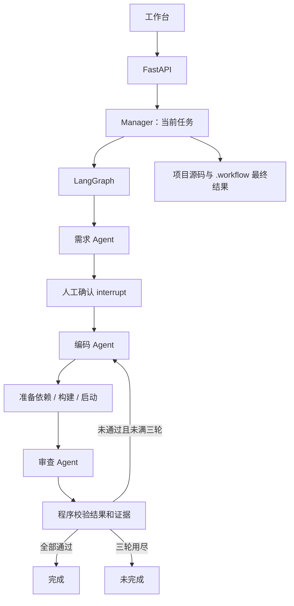

# 软件开发 Workflow：技术设计

版本：v2，2026-10-24。对应 [精简版需求](requirements.md)。

## 架构

React 工作台通过 FastAPI 提交任务和确认，SSE 展示当前事件。Manager 仅拥有一个当前任务、一个 LangGraph 图和受管应用进程。运行状态在内存，旧 SQLite 数据库不再读取。

三个角色使用独立提示词、工具范围和 Pydantic 输出类型，内部通过 LangChain `create_agent` 调用模型。可使用同一模型配置，角色上下文按需传递，不把全部聊天历史交给下一角色。

## 共享状态和分支

主要字段为 `request`、`plan`、`coding_result`、`runtime`、`review_report`、`issues`、`repair_count`、`is_repair`、`status` 和 `phase`。

需求节点输出提案后，确认节点调用 `interrupt()`；内存 Checkpointer 保存本会话等待点。API 只允许当前等待任务接受确认，状态检查及异步锁阻止重复启动，无修订号或决定数据库。

编码后按结构化启动方案安装依赖、构建并启动服务。项目构建/启动失败进入同一结果判断；环境安装或模型异常由管理器终止任务。审查未通过且已完成修复小于三轮时设置修复标志返回编码。首次实现不计数，修复后的结果判断增加一次计数；最多三轮后直接失败结束。

停止通过取消 asyncio 任务阻止后续节点，命令工具清理子进程，浏览器关闭；源码不回滚。关闭服务不恢复，下一次修改需要显式选择原目录重新提交。

## 工具与结果

文件工具规范化路径并限制在选定目录；新建时先验证空目录，第一次编码前再核对。工具自身代码和依赖目录不可作为目标。`.workflow` 是报告目录，从 Agent 文件列表和源码指纹中排除。

服务使用直接程序/参数调用，不使用 shell，保留超时和子进程清理；等待 HTTP 健康检查通过后提供预览地址。一个工作台管理一组当前应用服务，切换任务前先停止旧实例。

审查可运行登记检查、发送 HTTP 请求、操作 Playwright 浏览器并断言。报告必须完整对应确认清单，证据 ID、类型、通过状态与本轮源码指纹匹配；代码类可用源码或登记测试证据。检查前后源码变化则拒绝本轮结果。

执行上下文的浏览器和完整工具结果留在临时目录/内存，不能进入图共享状态。结束后将报告所需证据、简短事件日志及最多三张截图写到项目 `.workflow`；临时目录在下一任务或服务关闭时清理。报告只代表该次执行，不能证明后续手动修改后的源码已通过。

文件路径检查和子进程环境过滤不等于操作系统沙箱，代码与依赖以当前用户权限运行。

## 接口

| 接口 | 用途 |
| --- | --- |
| `GET /api/health`、`POST /api/pick-directory` | 服务状态、Windows 目录选择 |
| `GET /api/current`、`POST /api/runs` | 当前任务、新建或修改需求 |
| `GET /api/runs/{id}` | 本次状态、方案和结果 |
| `POST /api/runs/{id}/decision` | 确认或结束 |
| `POST /api/runs/{id}/stop` | 停止 |
| `GET /api/runs/{id}/events` | 本会话事件流，按 ID 补读 |
| `GET /api/runs/{id}/report`、`screenshots/{name}` | 本次报告与关键截图 |
| `POST/DELETE /api/runs/{id}/preview` | 当前预览重启/停止 |

SSE 只展示事件，断线不取消执行。无历史查询、旧任务恢复或重试接口。仅接受本地工作台来源，模型密钥不返回前端，不传给生成应用。

## 扩展

角色定义在 `agents.py`，协议在 `models.py`，工具在 `tools.py`，图连接集中在 `workflow.py`。新增角色时补充输出类型、工具范围和节点连接即可复用现有角色。特别的结果展示再扩充前端；不需要把任务历史和数据库机制重新引入流程。
