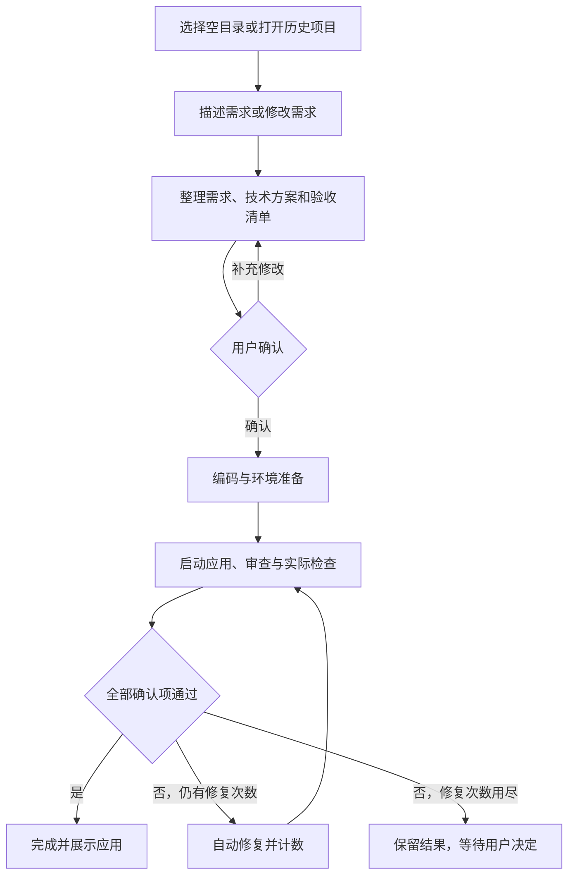

# 通用软件开发工作流：需求文档

版本：v1.1，需求与技术选择已确认  
更新日期：2026-10-22

本文整理已经确认的产品需求，作为后续设计、开发和验收的依据，不代表功能已经实现。明确列为设计建议或待核对的事项，不作为已经完成的能力。

## 1. 产品目标

使用 LangGraph 构建一个通用的软件开发工作流。用户提出需求，系统整理需求并请用户确认，再自动完成编码、审查、实际运行检查，以及必要的修复。

用户希望“软件开发应该简洁而且没有局限”。产品应尽量减少用户的操作负担，同一套流程能够服务不同类型的软件项目。

项目需要方便展示：用户能够查看工作流过程，并直接操作生成的软件，观察开发结果与修复效果。

## 2. 已确认的产品选择

| 项目 | 已确认的要求 |
| --- | --- |
| 编排框架 | 使用 LangGraph，独立设计本次项目，不要求依赖项目1的代码。 |
| 产品方向 | 软件开发工作流，覆盖需求、编码、审查与必要的修复。 |
| 生成范围 | 同时覆盖单页网页小应用、多页面前端应用，以及带后端和数据库的完整应用。 |
| 人工参与 | 系统展示功能清单、页面结构、技术方案和验收清单；用户可以补充修改，确认后进入后续开发和审查流程。 |
| 审查方式 | 阅读代码并实际运行检查，展示每条验收项的通过、失败或未执行状态；所有确认的验收项通过后才标记完成。 |
| 运行方式 | 在用户的 Windows 电脑上启动，通过浏览器使用，支持现场展示或录屏。 |
| 演示要求 | 成果直观，方便展示，能够明显看出成效。 |
| 测试用例 | 使用比较简单的例子测试和演示。 |
| 技术栈选择 | 用户可以指定语言、框架和数据库；未指定时，由 Agent 提出方案，与需求一起交给用户确认。 |
| 项目修改 | 支持新建项目，也支持对本系统生成的项目继续提需求、修改代码。 |
| 环境与服务 | 系统为每个项目准备依赖，自动安装依赖并启动、停止本地服务。 |
| 自动修复 | 默认最多自动修复3轮；仍未通过时保留代码和检查结果，展示未解决问题，由用户选择继续修复、修改需求或结束。 |
| 模型候选 | 用户接受 `deepseek-flash` 或 `openai-6-luna`；实际服务端模型 ID 和接入方式待核对。 |
| 工作目录 | 用户选择本地文件夹作为项目开发目录，系统在其中开发，源码可直接在本地查看。源码压缩包导出不列为必需功能。 |
| 展示界面 | 使用可视化工作台，需求对话、Agent 执行进度、应用预览同屏展示，代码和审查报告可切换查看。 |
| 历史保存 | 保存项目代码、确认后的需求和执行记录；系统重新启动后可以打开历史项目并继续提出修改需求。 |
| 新项目目录 | 新建项目必须选择空文件夹；发现已有文件时提示另选空文件夹。本系统已登记的历史项目可以直接打开。 |
| 停止与重试 | 提供停止按钮，保留源码和执行记录；重新打开后查看进度并手动重试，中断任务不自动恢复。 |
| 版本管理 | 第一版仅保留最新源码和修改记录，不提供版本回退功能。 |

## 3. 生成范围

下列三类均属于用户要求的产品范围，不能将产品范围默认为仅支持单页网页。

| 类型 | 需要体现的能力 | 简单示例，仅供后续选择 |
| --- | --- | --- |
| 单页网页小应用 | 生成可直接操作的页面及交互逻辑。 | 番茄钟、抽签器。 |
| 多页面前端应用 | 生成多个页面及页面间导航。 | 包含首页、列表和详情页的小应用。 |
| 带后端和数据库的应用 | 生成前端、后端接口及数据存储相关代码，并组织其运行。 | 可以保存并重新查询待办事项的小应用。 |

技术栈不预先固定。用户可以指定语言、框架和数据库；未指定时，由 Agent 提出方案，与需求一起交给用户确认。具体模型服务、首批验证的技术组合和环境兼容情况在接入时核对。三类应用的覆盖要求不等于已经验证任意技术组合。

本版确认的项目来源包括新建项目和本系统已经生成的项目。导入外部已有项目尚未纳入本版确认范围。

第一版保持操作简洁：不要求源码压缩包导出、外部项目导入、自动恢复中断任务或历史源码版本回退。以上简化不改变三类应用均纳入生成范围的要求。

## 4. 核心使用流程

1. 用户新建项目并选择本地空文件夹，或打开本系统的历史项目提出修改需求。新建时发现文件夹非空，应提示另选空文件夹，保留其中已有内容。
2. 系统整理功能清单、页面结构、技术方案和验收清单；用户可以补充修改，确认后开始开发。用户指定的技术栈应纳入方案。
3. 用户确认后，系统自动进入编码阶段，准备项目依赖并安装所需依赖。
4. 系统启动本地服务，开展代码审查，并实际打开页面、操作关键功能。
5. 发现问题时，将问题交回编码阶段修复，再次检查；默认最多自动修复3轮。
6. 展示逐项检查结果；所有确认的验收项通过后标记完成，用户可以操作生成的软件并在本地查看源码。
7. 修复次数用尽仍未通过时，保留代码和检查结果，展示未解决的问题，等待用户选择继续修复、修改需求或结束。

修复轮数不包含首次编码，每轮自动修复应包含修改和重新检查。环境准备、服务启动等步骤的具体先后顺序可按项目需要调整。

修复后的项目自身构建或启动检查仍然失败，也计为一轮检查失败；不要求成功打开页面才计数。安装、模型服务或工具故障造成的中断另行记录。

每一批自动修复最多3轮。预算用尽后，只有用户明确选择“继续修复”，才开启下一批最多3轮；各批次的执行记录和累计修复次数需要保留。选择修改需求时返回需求确认步骤；选择结束时保留结果并停止本次任务。

项目源码、确认后的需求和执行记录需要保存，重新启动系统后仍可打开。继续修改时重新整理并确认本次需求，更新对应的验收清单。

### 4.1 流程示意

停止、执行失败和系统中断按第7.4节处理。

## 5. 功能需求

| 编号 | 功能 | 状态 |
| --- | --- | --- |
| FR-01 | 接收自然语言软件需求。 | 已确认 |
| FR-02 | 展示可补充修改的功能清单、页面结构、技术方案和验收清单；用户确认后开始编码，支持用户指定技术栈。 | 已确认 |
| FR-03 | 使用同一套工作流开发第3节所列三类应用。 | 已确认；具体技术组合在设计与接入时验证 |
| FR-04 | 需求确认后自动开展编码、审查、检查与必要的修复；默认最多自动修复3轮，仍未通过时等待用户决定。 | 已确认 |
| FR-05 | 审查包含代码检查、实际页面操作，以及适用的接口和数据读写检查；每项标记通过、失败或未执行，全部确认项通过后才标记完成。 | 已确认；具体证据格式待设计 |
| FR-06 | 提供本地浏览器中的可视化工作台，同屏显示需求对话、Agent 执行进度和应用预览，支持切换查看代码和审查报告。 | 已确认；视觉样式待设计 |
| FR-07 | 新建项目时选择本地空文件夹，直接在其中生成源码；非空时提示另选目录，历史项目可直接打开。 | 已确认 |
| FR-08 | 显示当前执行阶段、Agent 进度和审查结果，修复时更新相关进度和检查结论。 | 已确认；具体事件和展示方式待设计 |
| FR-09 | 保存最新源码、确认后的需求和执行记录，系统重启后可打开历史项目继续修改；中断任务不自动恢复。 | 已确认 |
| FR-10 | 为每个项目准备依赖、自动安装依赖，并管理本地服务的启动与停止；运行失败时保留结果供查看和手动重试。 | 已确认；服务管理细节待设计 |
| FR-11 | 使用选定模型服务执行 Agent 任务，候选为 `deepseek-flash` 或 `openai-6-luna`。 | 候选已确认；实际模型 ID 和接口待核对 |
| FR-12 | 允许用户停止当前任务，保留源码、当前阶段和执行记录，之后由用户手动重试。 | 已确认 |
| FR-13 | 继续修改时维护最新源码和修改记录，第一版不提供历史源码版本回退。 | 已确认 |

## 6. Agent 分工

第一版采用以下三个角色。LangGraph 编排角色之间的流程，各角色内部使用 LangChain 的工具调用循环；具体工具和输入输出由技术设计定义。

| 角色 | 职责 | 主要交接内容 |
| --- | --- | --- |
| 需求 Agent | 将用户描述整理为可确认的需求，结合用户指定或系统推荐的技术栈提出方案。 | 确认后的需求清单和技术方案。 |
| 编码 Agent | 根据需求开发软件，根据检查反馈修复问题。 | 项目代码、运行方法和修改说明。 |
| 审查 Agent | 对照需求检查代码，结合真实运行结果判断功能是否满足要求。 | 检查结论、问题位置、问题原因和修复建议。 |

测试执行、服务启动等操作由普通工具或程序节点完成，再将结果交给 Agent，不额外计为 Agent 角色。

Agent 之间需要交接确认后的需求、技术方案、开发目录、产物说明、逐项验收结果和待修复问题。LangGraph 负责组织这些阶段及状态流转。具体字段、存储格式、工具接口和上下文组织方式在设计文档中定义。

## 7. 工作台与本地项目

### 7.1 需求确认

需求确认内容包括功能清单、页面结构、技术方案和验收清单。用户可以补充或调整内容，系统据此更新方案，用户确认后进入开发阶段。

修改已有生成项目时，也需要明确本次修改内容和对应的验收项，确认后再执行。

### 7.2 工作台展示

工作台需要同屏呈现需求对话、Agent 执行进度和生成应用的预览，并支持切换查看项目代码及审查报告。

进度信息应能帮助用户理解当前由哪个角色处理什么任务、处于哪个阶段，以及是否正在修复问题。具体布局、配色、日志详细程度和证据展示方式在界面设计时确定。

### 7.3 项目文件与历史

用户选择本地文件夹作为开发目录。生成的源码保存在该目录中，用户可以通过文件管理器或编辑器直接查看。压缩包下载不列为必需功能。

系统保存项目对应的目录、确认需求和执行记录。应用重新启动后，可以找到历史项目并继续修改。记录的具体文件名和存储位置由实现设计确定。

新建项目要求空文件夹，发现已有文件时提示用户另选目录，不自动清空或覆盖原有内容。已登记的历史项目通过历史列表打开，允许按确认的修改需求更新其中的源码。

第一版只保留最新源码和修改记录，不要求保留可恢复的历史源码快照。修改记录用于说明发生了什么，不提供代码版本回退。

### 7.4 停止、失败与重新打开

用户可以停止当前任务。系统需要保留当前最新源码、所处阶段和执行记录，停止继续调度后续 Agent，并结束本次执行中由系统管理的相关任务。

执行失败时展示失败阶段、原因和已有结果，保留记录供用户手动重试。执行未成功结束时，不得显示为开发完成。

失败处理分为两类：

- 项目代码的构建报错、应用启动报错和功能检查失败：将错误日志或检查结果交回编码阶段，使用同一批最多3轮的自动修复预算。
- 依赖下载或安装失败、缺少系统运行环境、模型服务不可用或工作流工具本身发生故障：停止本次自动流程，保留结果和错误说明，等待用户处理后手动重试。这些情况不作为已完成的代码修复轮次。

重新启动系统后，用户可以查看历史项目及上次进度。此前中断的执行不自动恢复，用户明确选择重试后再开始执行。具体的重试起点在后续设计中定义，不承诺从任意中断位置恢复。

手动重试不跳过需求确认，也不自动清零同一需求的修复预算。本批修复次数用尽时，仍需用户明确选择继续才开启下一批。

停止或失败时保留的是当时最新源码，可能包含尚未完成或未验收通过的修改；第一版不自动回退源码。

## 8. 验收规则

### 8.1 项目完成标准

以用户确认的验收清单为依据，逐项检查并显示结果。

| 检查范围 | 适用情况 | 检查内容 |
| --- | --- | --- |
| 页面与交互 | 有网页界面的项目 | 实际打开页面，操作与需求有关的关键功能，检查操作结果。 |
| 接口 | 包含后端接口的项目 | 实际调用相关接口，检查响应及对应功能。 |
| 数据读写 | 包含数据存储需求的项目 | 实际保存、读取并核对数据，覆盖需求涉及的相关操作。 |
| 代码审查 | 所有生成项目 | 对照需求检查实现，记录问题和修复建议。 |

每个验收项标记为“通过”“失败”或“未执行”。只有所有确认的验收项通过，才可将本次开发任务标记为完成。失败项和未执行项需要保留说明，未通过时进入修复或等待用户决定的流程。

Agent 需要引用实际运行结果形成检查结论。缺少运行证据时，不能将自述当作测试通过的依据。

验收清单应根据项目实际功能确定：包含接口和数据存储的项目才需要相应检查。自动修复不应自行删除或降低用户已经确认的验收要求；变更需求时重新交给用户确认。

### 8.2 验收记录

为每次任务保留输入需求、确认内容、产物路径和说明、实际运行操作、逐项检查结果、修复记录和未解决问题，便于演示和后续修改。源码以项目目录中的最新内容为准，不要求为每次任务另存历史源码副本。

具体证据可以采用命令输出、接口响应、浏览器操作结果和截图等形式，按实际检查需要设计。未执行的检查应明确标注。

历史检查报告对应当次任务。再次修改源码后，需要重新检查本次确认的验收清单，不能将旧报告当作当前源码已经通过的依据。

首次验收使用单页计数器、多页面学习站和 SQLite 留言板；实际结果见 [验证记录](validation.md)。

## 9. 工作流系统的验收清单

下列条目用于验收本系统自身；第8节用于验收每次生成的软件。这里定义检查目标，不表示这些检查已经执行。

| 编号 | 验收场景 | 预期结果 |
| --- | --- | --- |
| AC-01 | 新建项目选择非空目录。 | 提示另选空目录，已有文件保持原样。 |
| AC-02 | 输入需求并补充或调整确认内容。 | 功能清单、页面结构、技术方案和验收清单同步更新；确认后才启动编码。 |
| AC-03 | 用户指定技术栈，或未指定技术栈。 | 采用用户指定方案，或提出方案交给用户确认。 |
| AC-04 | 使用简单需求生成一个单页网页小应用。 | 实际页面可操作，源码在选定目录中，逐项验收有运行依据。 |
| AC-05 | 使用简单需求生成一个多页面前端应用。 | 页面与导航符合确认需求，逐项验收有运行依据。 |
| AC-06 | 使用简单需求生成一个带后端和数据库的应用。 | 前端可用、相关接口可调用、数据可保存和读取，逐项验收有运行依据。 |
| AC-07 | 观察一次完整执行过程。 | 工作台能看到角色执行进度、需求交接、应用预览和审查结果。 |
| AC-08 | 检查发现未通过项。 | 问题交回编码阶段修复并重新检查；自动修复默认最多3轮，首次编码不计入。 |
| AC-09 | 三轮自动修复后仍未通过。 | 保留代码、记录和未解决问题，等待用户选择；明确选择继续后才开始下一批最多3轮，累计记录保留。 |
| AC-10 | 存在失败或未执行的确认验收项。 | 本次任务不标记为完成，界面明确显示对应状态。 |
| AC-11 | 关闭并重新打开系统。 | 历史项目、需求和记录可查看；中断任务不自动恢复，可由用户手动重试。 |
| AC-12 | 对历史项目继续提出修改需求。 | 确认本次修改后更新原项目，保留最新源码和修改记录。 |
| AC-13 | 在执行中主动停止，或执行发生失败。 | 不显示为完成，保留源码、当前阶段和记录，允许后续手动重试。 |
| AC-14 | 项目构建或启动报错，以及依赖安装等执行条件失败。 | 项目构建或启动报错进入有次数上限的代码修复；依赖安装或外部服务等失败停止本次自动流程，等待手动重试。 |
| AC-15 | 修改曾经验收通过的项目。 | 旧报告保留为历史记录，本次完成状态以修改后的实际检查结果为准。 |

## 10. 后续设计与接入事项

产品范围和主要使用规则已经明确，已确认技术选择见第11节，设计方案见 [技术设计文档](design.md)。以下具体事项在技术设计或实际接入时落实，保持当前需求约定：

- 核对实际模型服务、模型 ID 和接口格式。候选名称按用户提供的称呼记录，不假定可直接用于 API 请求。
- 落实已确认的前后端技术方案、独立模型配置和 SQLite 本地存储。
- 定义 Agent 输入输出协议、共享状态、消息交接和工具权限。
- 确定目录选择交互、技术栈环境检查、依赖安装和服务进程管理方式。
- 确定停止操作的响应方式、失败后的手动重试起点，以及预览服务的启动和关闭规则。
- 设计工作台视觉样式、执行事件、报告格式与检查证据的展示方式。
- 选择简单的演示需求，分别验证三类应用，并如实记录验证结果。

## 11. 已确认的技术选择

| 项目 | 已确认方案 |
| --- | --- |
| 工具自身后端 | Python + FastAPI。 |
| 工具自身前端 | React + TypeScript + Vite。 |
| 外层编排 | LangGraph，负责需求、编码、审查、人工确认和有次数限制的修复流程。 |
| Agent 内部执行 | LangChain 的现成工具调用循环，项目自行实现提示词、具体工具和结果校验。 |
| 执行并发 | 第一版同时只执行一个开发任务，支持保存和打开多个历史项目。 |
| 模型服务 | 沿用原 Agent 使用的服务，为新项目单独配置，不修改原项目设置。 |
| 本地保存 | SQLite 保存项目、需求、执行和检查记录，源码保存在用户选择的项目目录。 |
| 浏览器检查 | Playwright 负责实际打开页面、操作应用和收集检查证据。 |

这里确定的是工作流工具自身的实现技术栈，生成项目的技术栈仍按用户指定或 Agent 提案确认。具体模型适配和工具调用能力需要接入验证。
