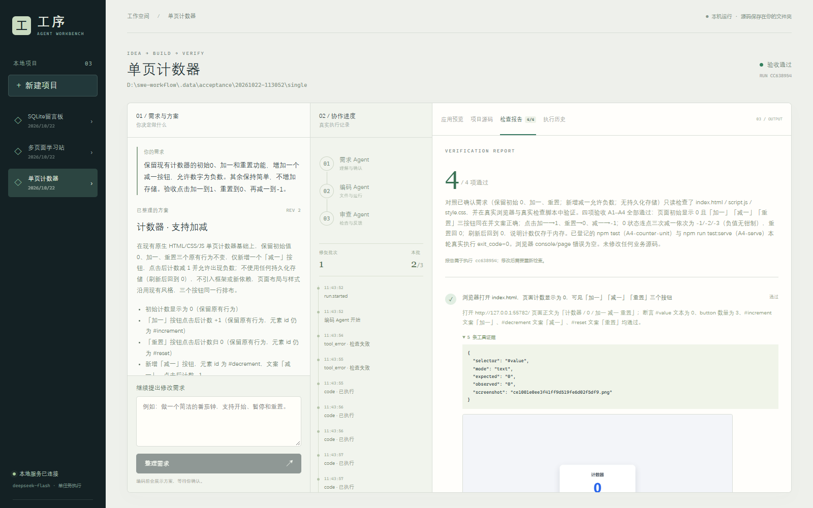

# MVP 验证记录

日期：2026-10-22。环境：Windows、Python 3.11.9、Node.js 24.11.1。模型为本项目独立配置的 `deepseek-flash`，通过 Anthropic Messages 兼容服务调用。没有导入旧 `D:\Agent` 代码，也没有修改其配置。

以下分开记录模拟流程、真实模型、实际应用和界面检查。示例均为简单功能，不代表任意需求和技术栈都能成功。

## 1. 离线与本地自动检查

MVP 首次验收：18 项通过。结构化结果恢复改进后的最终执行：`.venv\Scripts\python.exe -m pytest -q tests`，**25 passed**。

覆盖：空目录保护和路径越界；提案 ID 唯一；无证据/旧源码证据/缺项不能通过；数据库数据不影响源码指纹；确认前不写代码；过期与重复确认；角色顺序；三轮修复及明确开启下一批；启动失败计入预算；重试继承预算；未确认任务的失败重试；重建管理器恢复人工等待；单活动任务和取消；构建与依赖故障区别；API 读源码/证据/SSE/报告失效/来源限制；命令工具协议和真实 Python 子进程。

状态机测试使用模拟 Agent 和模拟服务，不证明模型生成质量。命令工具回归测试实际执行 Python `print(17+25)`，核对退出码与 `42`，未使用模拟输出。

前端 `npm run build` 通过 TypeScript 与 Vite 构建。PowerShell 安装/启动脚本另作语法检查；当前环境的依赖安装、浏览器安装、构建和启动已经实际执行，新机器全新安装尚未复现。

## 2. 真实模型协议检查

`scripts/check_model.py` 在实际服务上完成两项往返，最终 `passed=true`：

- 模型调用本地加法工具计算 17+25，返回结构化结果 42。
- 模型调用项目实际 `run_command` 工具，执行 Python `-c "print(17+25)"`，真实退出码 0、标准输出 42，再返回结构化结果。

记录：`.data/model-probe.json`；实际命令证据：`.data/runs/protocol-probe/evidence.jsonl`。未验证其他模型别名、服务商或逐 token 输出。

## 3. 三类生成应用

`scripts/live_acceptance.py single multi database` 顺序调用公开 API、真实模型和实际浏览器工具。测试脚本仅对自己创建的需求自动确认，并断言确认前项目目录仍为空。

| 例子 | 结果 | 自动修复 | 实际验证 |
| --- | --- | --- | --- |
| 单页计数器 | completed，3/3 | 0 轮 | 初始 0，点击加一变 1，点击重置回 0；页面断言与截图 |
| 多页面学习站 | completed，3/3 | 1 轮 | 首页→关于页→首页，输入小明得到问候，静态服务/脚本检查 |
| SQLite 留言板 | completed，3/3 | 0 轮 | 浏览器提交并显示留言；POST 创建再 GET 按 id 核对；页面刷新数据仍在；SQLite 相关登记检查 |

这次运行的根目录是 `.data/acceptance/20261022-113052/`，包含各例子的确认提案、最终执行 JSON、生成源码和 `summary.json`。三例分别约 66、175、87 秒，仅为本次运行耗时，不是性能承诺。

对应执行：

- 单页：`2bec788316a04567bbf27d849be5cebc`
- 多页面：`c606a9a037654b88afb7cbb272b6096e`
- SQLite：`6f95a8ab541642e5b0f274a0c8ab36e8`

完整实际工具证据和截图分别位于 `.data/runs/<run_id>/evidence.jsonl` 与同目录 PNG。第一次多页面报告因证据类型不满足校验被退回，首次失败和修复事件均保留。后续发现代码类验收应允许登记测试的实际成功证据，已修正该判定并加入回归测试；没有修改原始历史结果。

## 4. 工作台真实浏览器检查

使用 Playwright CLI 操作实际构建后的工作台，已确认：

- 侧栏打开三个项目；服务重启后记录仍可读取，没有自动启动任务。
- 非空 `docs` 目录被拒绝登记，界面显示明确提示，未清理该目录。
- 在已有计数器中提出“增加减一、允许负数”，再次停在可编辑提案；修改标题、删去额外验收项后确认，实际 `plan_revision=approved_revision=2`。
- 源码页可打开实际 `index.html`；历史页保存初始任务、被停止任务和手动重试任务。
- 继续修改测试暴露代码检查证据类型误判；停止测试后修复并从工作台手动重试。最终执行 `cc6389548b4244e5a0b1ede26e90ecc1` 为 completed、4/4，通过真实页面交互和登记脚本；继承修复预算，累计完成两轮，未清零。
- 打开最初的计数器报告时显示“源码已变更，需重新检查”，当前通过数为 0/3，旧结果仅作历史记录。
- 展开报告可以读取实际工具参数/观察结果并显示截图，点击截图可独立打开。
- 重启后的历史预览最初显示未启动，点击启动预览后重新运行；SQLite 留言仍存在。不同项目预览由同一服务管理器切换。
- 1600×1000 桌面布局已截图并视觉检查。工作台页面重新加载后的控制台没有未处理的脚本错误；重启期间连接失败与非空目录测试的预期 HTTP 400 不计作正常运行成功结果。

检查过程中另修正了 LangChain 工具协议中的参数名冲突：函数参数 `args` 被框架处理为 `v__args`，导致编码角色的短命令工具失败；已改为 `arguments`，最终离线真实子进程测试及真实模型命令探针均通过。之前的失败证据仍保留，未伪装成成功。

## 5. 需求验收对应与边界

| 需求项 | 验证依据 |
| --- | --- |
| AC-01～03 | 空目录/确认测试、非空目录界面检查、三个案例按指定技术实现 |
| AC-04～06 | 三类真实生成应用及运行证据 |
| AC-07 | 工作台实际操作、执行事件、预览与报告截图 |
| AC-08～10 | 真实多页面修复；模拟测试验证三轮上限、明确继续、失败不能完成 |
| AC-11 | 实际服务重启后历史可读；模拟检查点恢复；执行中不自动恢复由启动状态处理实现 |
| AC-12～13 | 历史计数器继续修改、真实停止/手动重试与保留记录 |
| AC-14 | 模拟构建/启动/安装故障与预算测试；未人为破坏真实网络下载 |
| AC-15 | 源码指纹 API 测试与历史报告界面失效提示 |

尚未验证：Windows 原生文件夹选择弹窗的人工交互（绝对路径输入已验证）、新机器安装、手机布局、多用户/多进程、任意第三方技术栈、其他模型、复杂长任务。当前源码指纹按 `tools.py` 列出的 Web/Python 文件和项目配置计算；增加其他语言时需扩充该规则。它不保存历史源码，也不等于完整文件版本控制。

模型解释是否完整覆盖某条复杂验收要求仍依赖审查策略；程序能校验证据来源、类型、通过状态和源码指纹，不能自动证明自然语言要求的全部语义。生成代码/依赖/登记脚本在当前用户权限下运行，不是 OS 沙箱。未录制演示视频，也未生成最终课程提交压缩包。

## 6. 偶发缺少结构化结果的修正

用户报告编码阶段偶发 `CodingResult.model_validate(None)`，重试后可以继续。执行 `4437a82160bc4b77a36f0081d4fa0dea` 的记录确认命令已成功执行，随后因缺少编码结果而失败；旧记录没有保存模型停止原因，不能断言当时一定是输出长度上限或网络问题。

已核对安装的 LangChain 实现：配置 ToolStrategy 后，若模型以没有工具调用的普通消息结束，工具 Agent 仍可能返回 `structured_response=None`。原实现未处理这种情况便直接交给 Pydantic。

现在在校验前检查结果是否存在和有效；缺失时最多两次继续同一角色对话，保留已执行工具的真实结果和当前文件，不从空对话重跑。补全共享原来单轮超时，不清零工作流修复预算；再次失败以明确中文错误结束，不将空结果当成成功。记录每次缺失时模型停止原因、输入/输出 token 数及补全次数，前端显示补全进度。

新增七项回归检查使用真实 LangChain 工具循环配合可控模型响应：正常输出不补全；普通结束/长度上限两种缺失后继续并验证文件只写一次；连续缺失达到上限后失败且保留文件；错误结构化参数继续经过校验；补全不延长总超时；用户取消不触发补全。最终 25 项测试及前端构建通过，真实模型工具/命令与结构化输出探针再次通过。没有重新执行用户的业务项目，也没有替用户选择“继续修复”。
